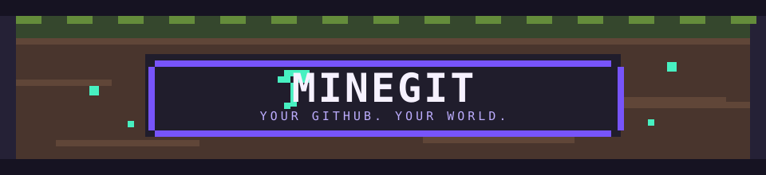
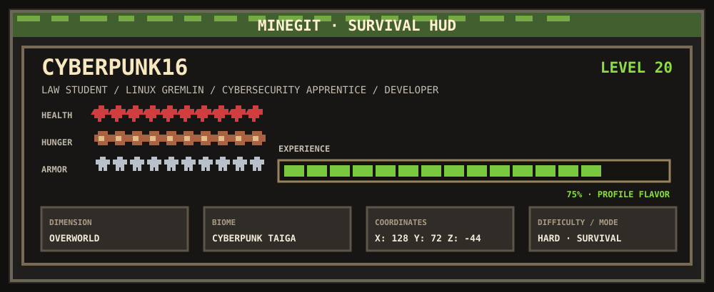
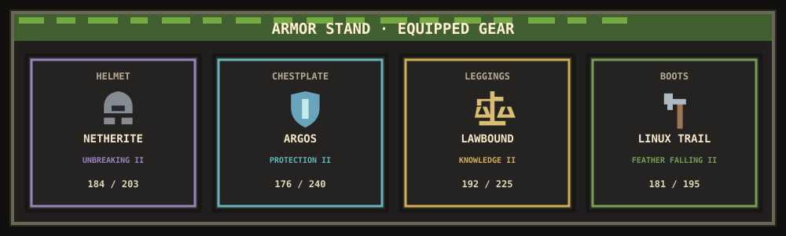
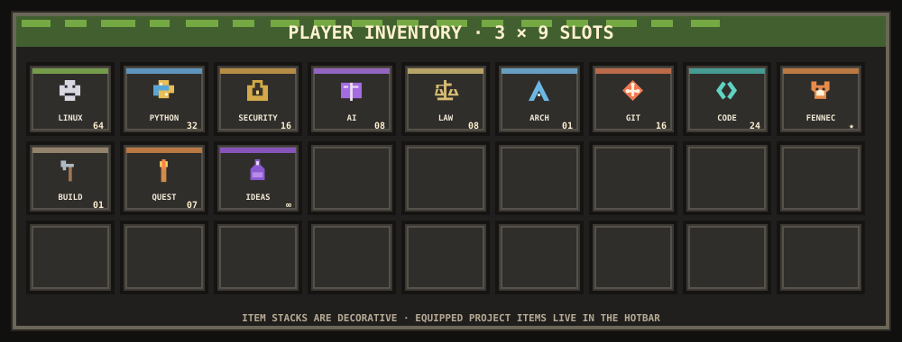
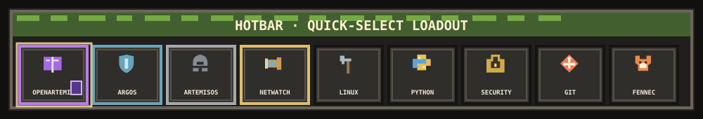
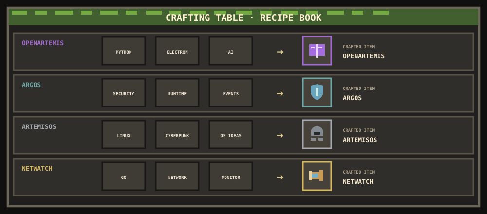
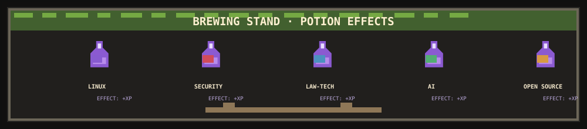
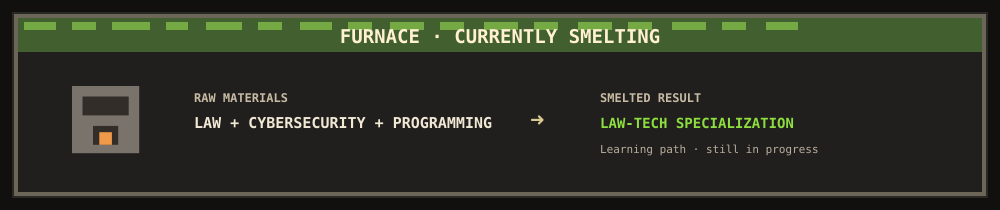
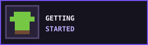

  

> **Your GitHub. Your world.** A player profile for `cyberpunk42016`, rendered as an original Minecraft-style inventory screen. All game values, enchantment levels, recipes, coordinates, and durability below are playful profile flavor—not GitHub statistics or game data.

## 🧭 PLAYER HUD

  

## 🧍 PLAYER PROFILE

| Player | Class | Spawn point |
|:--|:--|:--|
| **Cyberpunk16** · Level **20** | Law & Political Science Student · Cybersecurity Beginner · Linux Enthusiast · Developer | Algeria |

**Player notes:** Law student. Linux gremlin. Cybersecurity apprentice. Building software, breaking things legally, and surviving university.

## 🛡️ ARMOR EQUIPMENT

  

*The equipment is a metaphor loadout; enchantments and durability are fictional UI flavor.*

| Slot | Equipped item | Lore | Enchantments | Durability |
|:--|:--|:--|:--|:--:|
| 🪖 Helmet | **ArtemisOS Netherite Helm** | Future OS ideas, forged in Linux. | Unbreaking II · Protection I | `184 / 203` |
| 🛡️ Chestplate | **ARGOS Shieldplate** | Keep the realm and its runtimes guarded. | Protection II · Thorns I | `176 / 240` |
| 🩳 Leggings | **Lawbound Leggings** | Built for long lectures and longer quests. | Knowledge II · Mending I | `192 / 225` |
| 👢 Boots | **Linux Trail Boots** | Sure footing across terminal terrain. | Feather Falling II · Efficiency I | `181 / 195`* |

*Durability values are made-up game UI flavor; they do not describe real project progress.*

## 🎒 PLAYER INVENTORY

  

**Inventory notes:** Linux stack · Python toolkit · Cybersecurity field kit · AI components · Law tome · Git checkpoints · Programming tools. Stack counts are decorative.

## ⚔️ HOTBAR

### Active Builds · Selected hotbar items

  

| Slot item | Profile loadout |
|:--|:--|
| 📘 **Enchanted Book / Command Block** | **OpenArtemis** — AI desktop assistant. Stack: Python · Electron · JavaScript (Node.js). In progress in the local workspace; no account repository is verified. |
| 🛡️ **Shield** | **ARGOS** — security-focused software/runtime project. Exploring; its stack and repository aren’t listed in the connected account. |
| 🪖 **Netherite Helmet** | **ArtemisOS** — cyberpunk Linux operating system project. In progress; its stack and repository aren’t listed in the connected account. |
| 🔭 **Spyglass** | **[Netwatch](https://github.com/cyberpunk42016/Netwatch)** — security and system monitoring toolkit. Stack: Go · Python plugins. Active; [open verified repository](https://github.com/cyberpunk42016/Netwatch). |

*These item mappings are thematic. Netwatch is the only one of these builds with a verified repository in the connected account; OpenArtemis is present locally without a Git remote.*

**🦊 Fennec companion:** Rare · Passive · `+10 stealth` · `+100% terminal vibes` *(purely for fun).*

## 🧰 CRAFTING TABLE

*These are MineGit flavor recipes, not implementation manifests. Ingredient names describe concepts unless a stack is listed above.*

| Recipe | Crafting ingredients | Output |
|:--|:--|:--|
| **OpenArtemis** | Python + Electron + AI | 📘 Enchanted Book / Command Block |
| **ARGOS** | Security concepts + Runtime components | 🛡️ Shield |
| **ArtemisOS** | Linux + Cyberpunk aesthetic + OS ideas | 🪖 Netherite Helmet |
| **Netwatch** | Go + Network monitoring | 🔭 Spyglass · [verified repository](https://github.com/cyberpunk42016/Netwatch) |

## 📖 ENCHANTMENT TABLE

*Levels are playful loadout labels, not proficiency measurements.*

| Enchantment | Level | Applies to |
|:--|:--:|:--|
| **Efficiency III** | III | Programming · turning ideas into builds |
| **Unbreaking III** | III | Linux · persistent terminal tinkering |
| **Protection II** | II | Cybersecurity · learning to defend systems |
| **Mending II** | II | Git · recovering and improving project work |
| **Knowledge III** | III | Law · university studies and digital rights |
| **Eye of Ender II** | II | OSINT · learning to follow public clues |
| **Infinity I** | I | AI · experiments and assistant projects |
| **Power I** | I | Python · scripts and prototypes |
| **Aqua Affinity I** | I | Web development · learning to build for the surface web |

## 🧪 BREWING STAND

  

*Interest potions are imaginary effects for this player screen.*

| Potion | Effect | Duration |
|:--|:--|:--:|
| **Potion of Linux** | `+10 Terminal Knowledge` | ∞ |
| **Potion of Cybersecurity** | `+8 Threat Awareness` | ∞ |
| **Potion of Law-Tech** | `+6 Digital Rights Insight` | ∞ |
| **Potion of AI** | `+7 Prototype Ideas` | ∞ |
| **Potion of Open Source** | `+5 Shared XP` | ∞ |

## 🔥 FURNACE · CURRENTLY SMELTING

  

*An ongoing learning direction, not a completed qualification.*

## 🏆 MINEGIT ADVANCEMENTS

*Custom MineGit milestones inspired by Minecraft naming. These are not official Minecraft achievements.*

| Advancement | MineGit unlock |
|:--|:--|
|  **Getting Started** | Started building projects and learning new tools. |
|  **Stone Age** | Started programming. |
|  **Hot Stuff** | Started learning cybersecurity. |
|  **Enchanting** | Built an AI project. |
|  **Eye Spy** | Started exploring OSINT. |
|  **Acquire Hardware** | Started the university questline. |
|  **Suit Up** | Equipping skills for the cybersecurity path. |
|  **🔒 The End** | Long-term quest: finish a major project and contribute to open source. |

## 📜 QUEST BOOK

### Main Quest · Active

- [ ] Become cracked at cybersecurity
- [ ] Build a powerful AI assistant
- [ ] Contribute to open source

### Side Quest

- [ ] Defeat the Ender Dragon *(for flavor)*

### Completed Quests

- [x] Survive university
- [x] Learn Linux
- [x] Build my first projects

### Active Quest

**Learn, build, repeat.** Keep studying law, cybersecurity, Linux, and software development.

## 🌲 BIOMES & DIMENSIONS

| Biome | Field notes |
|:--|:--|
| 🌲 **Cyberpunk Taiga** | Linux, programming, and open-source trails. |
| 🏜️ **Algerian Desert** | The player's real-world spawn region; study and build between quests. |
| 🔥 **Nether Development Hell** | Cybersecurity, CTFs, security research, debugging, and stubborn builds. |
| 🌊 **Open Source Ocean** | Future expeditions into shared projects. |
| ⚖️ **Village** | Law, technology, and digital rights. |
| 🌌 **End Dimension** | AI experiments and ambitious long-term builds. |

| Dimension | What happens there |
|:--|:--|
| **Overworld** | University, law, and everyday player life. |
| **Nether** | Hard debugging, deadlines, and broken builds. |
| **The End** | Major completed projects and long-term goals. |

## 👾 BOSS BARS

*Challenge bars are just a playful snapshot; they are not measured statistics.*

| Boss encounter | Boss bar |
|:--|:--|
| University exams | `████████░░` |
| Linux configuration | `███████░░░` |
| Learning cybersecurity | `██████░░░░` |
| Large project scope | `████████░░` |
| Debugging a broken build | `█████████░` |

## 🏗️ CURRENT BUILD

**Current focus:** cybersecurity foundations · AI assistant development · the university questline.

## 📊 SCOREBOARD

No repository, emerald, villager, contribution XP, or language totals are shown here; this profile keeps GitHub counts out of its static HUD.

## ☠️ DEATH SCREEN

> **You Died!**
>
> Cause: dependency conflict · missing environment variable · broken build · Git merge conflict · forgot to save
>
> **Respawn?** → `YES`

---

  ⛏️ MineGit v0.1 · Your GitHub. Your world. · Player: <a href="https://github.com/cyberpunk42016">cyberpunk42016</a>

